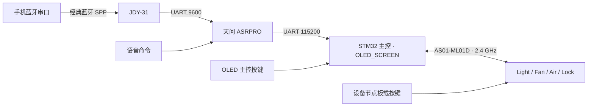

# 家庭智能网关

这是一个校级大学生创新创业训练项目。系统以 STM32F103C8T6 为主控，通过 OLED 菜单、天问 ASRPRO 离线语音识别和 JDY-31 手机蓝牙串口提供三种操作入口。主控通过 AS01-ML01D 2.4 GHz 无线模块，把控制指令发送到台灯、风扇、空调温度演示和门锁舵机四类节点。各节点也有独立的板载按键控制逻辑。

完整演示包含五份分别烧录的 STM32 固件和一份独立的 ASRPRO 工程。只验证 OLED 按键和无线控制时，准备一块主控和一个设备节点即可。

## 系统结构



| 工程目录 | 运行位置 | 主要功能 |
| --- | --- | --- |
| [OLED_SCREEN](OLED_SCREEN/) | 主控 STM32 | OLED 菜单、三个操作按键、串口接收、无线调度和应答提示 |
| [LED_control](LED_control/) | 台灯节点 STM32 | 使用 TIM3_CH1 PWM 调节亮度 |
| [FAN_control](FAN_control/) | 风扇节点 STM32 | 使用 TIM2 两路 PWM 和 DRV8833 驱动直流电机 |
| [DT.control](DT.control/) | 空调温度演示节点 STM32 | 使用四位数码管显示设定温度，关机时消隐 |
| [LOCK_control](LOCK_control/) | 门锁演示节点 STM32 | 使用 TIM3_CH1 PWM 控制舵机正反转，动作结束后恢复中位脉宽 |
| [家庭智能网关.hd](家庭智能网关.hd) | 天问 ASRPRO | 保存唤醒词、命令词、串口转发和识别回调的天问 Block 工程 |
| [蓝牙串口模块资料和 STM32 驱动代码](蓝牙串口模块资料和STM32驱动代码/) | 调试资料 | JDY-31 手册、PCB 封装、芯片手册和独立的蓝牙实验 |

## 代码结构与实现逻辑

### STM32 工程布局

- `Core/Src/main.c` 是各工程的启动入口，依次初始化 HAL、系统时钟、外设与应用模块。外设配置和中断入口分别位于 `Core/Src/` 的 `gpio.c`、`spi.c`、`tim.c`、`stm32f1xx_it.c` 等文件。
- `Core/Inc/` 存放头文件。设备节点的业务逻辑、无线驱动和数据解析存放在 `BSP/`，主控的同类文件放在 `Core/Src/`。风扇的 DRV8833 驱动也在该节点的 `Core/Src/`。
- `Drivers/` 随工程提供 STM32 HAL 和 CMSIS。`*.ioc` 用于在 STM32CubeMX 中查看或调整 MCU、时钟、引脚和外设配置。`MDK-ARM/*.uvprojx` 是 Keil µVision 的构建入口。

### 主控如何处理按键和串口

1. [主控入口](OLED_SCREEN/Core/Src/main.c) 初始化显示、设备数据、无线模块和串口 DMA，然后进入空闲循环。按键和串口操作由中断驱动。
2. [device_data.c](OLED_SCREEN/Core/Src/device_data.c) 保存各设备的状态与档位，[Screen_task.c](OLED_SCREEN/Core/Src/Screen_task.c) 负责绘制菜单和设备页，[Key_Task.c](OLED_SCREEN/Core/Src/Key_Task.c) 处理选择、编辑、提交和发送结果显示。
3. 外部串口数据进入 [RX_Handle.c](OLED_SCREEN/Core/Src/RX_Handle.c) 的 `HAL_UARTEx_RxEventCallback()`。主控通过 USART2 空闲检测和 DMA 接收，再调用 [RX_DataHandle.c](OLED_SCREEN/Core/Src/RX_DataHandle.c) 拆分字段，把命令重新封装为 `MAS` 格式，复用按键侧的无线发送逻辑，并更新主控缓存的数据。
4. 主控发送后切回接收模式，等待文本应答 `OK`。收到时显示 `Send Success!`，TIM4 超时则显示 `Send Fail!`。按 72 MHz 定时器时钟及当前 TIM4 配置计算，等待时间约 2 秒。OLED 上显示的开关与档位来自主控缓存，节点本地按键操作后不会主动回传状态。

### 设备节点如何处理命令

各节点在主循环中调用 `LED_handle()`、`FAN_handle()`、`Air_handle()` 或 `LOCK_handle()`。处理函数轮询无线数据，将收到的文本与前一帧比较以抑制连续重复包，再按设备名决定本地执行或转发。目标节点更新状态和档位、驱动输出，然后发送 `OK`。现有应答只有 `OK` 文本，用于反馈本次演示操作。

| 设备名 | 控制函数和源文件 | 输出及档位 |
| --- | --- | --- |
| `Light` | [LED.c](LED_control/BSP/LED.c) 的 `Light_control()` | `OFF,0` 关闭，开机可用 1–5 档，PWM 比较值为 20、40、60、80、99 |
| `Fan` | [FAN.c](FAN_control/BSP/FAN.c) 的 `FAN()` 与 [drv8833.c](FAN_control/Core/Src/drv8833.c) | `OFF,0` 停转。当前 1–3 档传给 DRV8833 的速度值为 50、75、100。菜单和语音提供 4 档，该值会触发数组越界 |
| `Air` | [DT.c](DT.control/BSP/DT.c) 的 `Air_control()` 和 [main.c](DT.control/Core/Src/main.c) 的 `LED4_Display()` | `ON` 时显示 16–32 的设定温度，`OFF` 时数码管消隐。此节点用于温度显示演示 |
| `Lock` | [LOCK.c](LOCK_control/BSP/LOCK.c) 的 `AAA()` | `ON,1` 与 `OFF,0` 触发两个方向的舵机动作，约 2.1 秒后输出回到中位脉宽。上电初始化时也会执行一次默认的 `OFF` 动作 |

### 命令格式

```text
来源,设备名,状态,档位
```

- 字段使用英文逗号分隔。设备名区分大小写，状态为 `ON` 或 `OFF`，档位为十进制整数。
- OLED 按键提交和主控无线转发使用 `MAS`，语音工程发出的文本使用 `ASR`。手机端可用 `BT` 标识来源，主控读取该字段后统一生成 `MAS` 无线帧。
- 无线驱动使用固定 32 字节载荷、共享的 5 字节地址 `Unite_ADDRESS`、射频信道 40 和 2 Mbps 空中速率。各板的无线配置需要一致。串口联调时，每次发送一条短文本并留出空闲间隔，便于 DMA 空闲接收识别命令边界。

| 输入文本 | 演示动作 |
| --- | --- |
| `BT,Light,ON,3` | 台灯打开并切换到三档 |
| `BT,Light,OFF,0` | 台灯关闭 |
| `BT,Fan,ON,2` | 风扇按二档命令运行 |
| `BT,Air,ON,26` | 数码管显示设定温度 26 |
| `ASR,Light,ON,1` | 识别到「打开台灯」时 ASRPRO 输出的串口文本 |

## 硬件与接线

- 每个运行中的 STM32 节点配一块 STM32F103C8T6 板和一个兼容 nRF24L01+ 的 AS01-ML01D 模块。射频模块使用 3.3 V 电源。各板与其外设共地，执行器按额定电压供电。 [AS01-ML01D 产品页](https://www.ashiningtech.com/products/00000003-0026-0000-0000-000000000026)
- STM32 通过 ST-LINK 的 SWD 接口烧录。SWDIO 接 PA13，SWCLK 接 PA14，并连接 GND 和烧录器要求的目标电压参考。
- 各 STM32 板的射频接线均为 SCK → PB13、MISO → PB14、MOSI → PB15、CSN → PA8、CE → PA9。固件轮询无线状态，射频模块的 IRQ 脚当前未使用。
- 主控 OLED 使用 PB6（SCL）和 PB7（SDA）。`OLED.c` 以软件 I²C 驱动这两个开漏引脚，7 位地址为 `0x3C`，对应写地址 `0x78`。SCL、SDA 需要上拉。

| 板卡 | 外设信号 | 本地按键 |
| --- | --- | --- |
| 主控 OLED | USART2 PA2/TX、PA3/RX，指示灯 PA12 | 上一项 PB11、确认 PB0、下一项 PA6 |
| 台灯 | PA6（TIM3_CH1） | 开关 PB5、加档 PB3、减档 PA10 |
| 风扇 | DRV8833 IN1 接 PA0（TIM2_CH1），IN2 接 PA1（TIM2_CH2） | 开关 PB7、加档 PB4、减档 PA15 |
| 空调演示 | 数码管 SCLK 接 PA4，RCLK 接 PA5，DIO 接 PA6 | 开关 PB7、升温 PB4、降温 PA15 |
| 门锁演示 | 舵机 PWM 接 PA6（TIM3_CH1） | PB7 切换状态。PA15 已配置为外部中断，当前按键逻辑读取 PB7 |

语音与蓝牙按以下方向接线，UART 两端 TX/RX 交叉连接，并连接 GND。

| 串口链路 | 引脚对应 | 速率 |
| --- | --- | --- |
| ASRPRO Serial1 ↔ 主控 USART2 | ASRPRO PA2/TX → 主控 PA3/RX，ASRPRO PA3/RX ← 主控 PA2/TX | 115200，主控为 8N1 |
| JDY-31 ↔ ASRPRO Serial2 | JDY-31 TXD → ASRPRO PA6/RX，JDY-31 RXD ← ASRPRO PA5/TX | 9600 |

## 编译、烧录与运行

### 1. 获取代码并准备工具

```powershell
git clone https://github.com/yanhun-kirito/-.git home-gateway
cd home-gateway
```

STM32 工程使用 Windows 上的 Keil MDK-ARM 和 µVision。项目配置记录的编译器为 Arm Compiler 5.06 update 7（build 960），设备包为 Keil STM32F1xx_DFP 2.4.1。用 ST-LINK 烧录 STM32。需要修改外设配置时可用 STM32CubeMX 打开对应 `.ioc`。语音与手机联合演示还需要天问 Block、ASRPRO 编程下载器和支持经典蓝牙 SPP 的手机串口工具。 [Keil 设备包](https://www.keil.arm.com/packs/stm32f1xx_dfp-keil/versions/) · [STM32CubeMX](https://www.st.com/en/development-tools/stm32cubemx.html) · [天问 Block](https://www.twen51.com/new/art_show.php?id=230)

### 2. 构建 STM32 固件

| 烧录目标 | 打开工程 | 编译后生成的 HEX |
| --- | --- | --- |
| OLED 主控 | [OLED_SCREEN.uvprojx](OLED_SCREEN/MDK-ARM/OLED_SCREEN.uvprojx) | `OLED_SCREEN/MDK-ARM/OLED_SCREEN/OLED_SCREEN.hex` |
| 台灯 | [LED_control.uvprojx](LED_control/MDK-ARM/LED_control.uvprojx) | `LED_control/MDK-ARM/LED_control/LED_control.hex` |
| 风扇 | [FAN_control.uvprojx](FAN_control/MDK-ARM/FAN_control.uvprojx) | `FAN_control/MDK-ARM/FAN_control/FAN_control.hex` |
| 空调演示 | [AAA.uvprojx](DT.control/MDK-ARM/AAA.uvprojx) | `DT.control/MDK-ARM/AAA/AAA.hex` |
| 门锁演示 | [LOCK_control.uvprojx](LOCK_control/MDK-ARM/LOCK_control.uvprojx) | `LOCK_control/MDK-ARM/LOCK_control/LOCK_control.hex` |

1. 用 µVision 打开对应的 `.uvprojx`，在 `Options for Target` 中确认器件为 `STM32F103C8`，编译器选用 Arm Compiler 5。
2. 点击 **Project → Build Target**，检查构建日志。工程已开启 **Create HEX File**，链接后会在表中的路径生成 HEX。
3. 将 ST-LINK 接到对应板卡。在 **Options for Target → Debug** 选择 **ST-Link Debugger**，选择 SW 端口并检查 STM32F10x 中容量 Flash 烧录算法。
4. 点击 **Flash → Download**，完成后复位或重新上电。其余板卡按相同过程分别烧录各自的固件。 [µVision Flash 下载文档](https://www.keil.com/support/man/docs/uv4cl/uv4cl_fl_hexdownload.htm)

也可以在 PowerShell 中构建单个工程。将 `$uv4` 替换为实际安装路径，并在仓库根目录运行。 `-o` 指定构建日志。Keil 命令行退出码 1 表示只有警告，可同时检查日志末尾的错误数和 HEX 输出。 [µVision 命令行文档](https://www.keil.com/support/man/docs/uv4/uv4_commandline.asp)

```powershell
$uv4 = 'C:\Keil_v5\UV4\UV4.exe'
$project = (Resolve-Path '.\OLED_SCREEN\MDK-ARM\OLED_SCREEN.uvprojx').Path
$projectDir = Split-Path $project
$buildLog = Join-Path $projectDir 'build.log'
$argsText = '-b "{0}" -j0 -o "{1}"' -f $project, $buildLog
$build = Start-Process -FilePath $uv4 -ArgumentList $argsText -WorkingDirectory $projectDir -Wait -PassThru
Get-Content -LiteralPath $buildLog -Tail 12
$build.ExitCode
```

项目团队已在实物板卡上验证可用。本次文档整理使用上述编译器在干净检出目录中复查构建，五个 STM32 工程和独立的 JDY-31 HAL 实验均生成 HEX，均为 0 个编译错误。四个设备节点各有 2 个字符缓冲区指针类型警告。

### 3. 先验证 OLED 与一个无线节点

1. 烧录 `OLED_SCREEN` 和 `LED_control`，接好两板的无线模块、主控 OLED 和台灯节点的 PWM 输出。
2. 两板上电后，用主控的上一项和下一项按键选中 `Light`，按确认进入设备页。
3. 选择状态或档位并再次按确认进入编辑。用上一项和下一项切换状态或调整数值，再按确认提交。设备页可通过 `<` 返回菜单。
4. OLED 显示 `Send Success!` 后观察台灯输出。再发送一个不同档位或关机命令，检查亮度和关机状态变化。设备节点可能过滤连续两条相同的文本命令。

### 4. 接入语音和手机蓝牙

1. 在天问 Block 选择 **ASRPRO** 主板，打开 [家庭智能网关.hd](家庭智能网关.hd)，生成语音模型。按模块的 Flash 容量及下载器接线选择匹配的编译下载选项。 [天问 Block 使用说明书](https://www.twen51.com/new/learning_show.php?id=559)
2. 连通 ASRPRO Serial1 与 OLED 主控的 USART2。说出唤醒词「小紫同学」，然后说「打开台灯」或「台灯三档亮度」。识别结果由 ASRPRO 程序发给主控。
3. 将 JDY-31 的 UART 设置为 9600 并接到 ASRPRO Serial2。手机使用支持经典蓝牙 SPP 的串口应用连接 JDY-31，以文本模式发送 `BT,Light,ON,3` 一类命令。`UART_RX` 线程将 Serial2 收到的文本转发到 Serial1，随后走与语音相同的主控路径。
4. 需要单独调试主控串口时，将 ASRPRO 与主控的串口线断开，用 3.3 V USB 转串口适配器接主控 USART2。设置为 115200 8N1，一次发送一条短命令，观察 OLED 的发送提示和设备实际动作。

蓝牙目录里的 `F103.uvprojx` 是独立的 JDY-31 HAL 实验，可用于测试模块串口和 AT 指令流程。网关的正式蓝牙接入运行于 ASRPRO 的 `UART_RX` 线程。

## 常见问题与当前边界

| 现象 | 检查顺序 |
| --- | --- |
| Keil 提示设备或编译器缺失 | 安装 STM32F1xx_DFP 2.4.1 和 Arm Compiler 5，确认当前 Target 选用正确编译器 |
| OLED 无显示 | 核对 PB6/PB7、开漏上拉、电源和 `0x3C` 地址，确认固件烧录到主控板 |
| OLED 显示 `Send Fail!` | 先用 `NRF24L01_Check()` 检查 SPI 是否正常，再核对两块板的射频配置、设备名和供电。风扇与门锁工程的 SPI2 原配置为 18 MHz，高于 nRF24L01+ 的 10 MHz 上限，联调时可将对应 SPI2 预分频调为 8（约 4.5 MHz）后重新编译。 [Nordic nRF24L01+ 规格书](https://docs-be.nordicsemi.com/bundle/nRF24L01P_PS_v1.0/raw/resource/enus/nRF24L01P_PS_v1.0.pdf) |
| 蓝牙已连接，设备无动作 | 先检查 JDY-31 ↔ ASRPRO 的 9600 串口，再检查 ASRPRO ↔ 主控的 115200 串口。确认 TX/RX 交叉、共地、设备名大小写正确，并分开逐条发包 |
| 发送相同命令时偶尔超时 | 节点按前一帧文本去重，换一个有效状态或档位再试 |
| 风扇四档输出异常 | `FAN()` 用档位直接索引四元素数组，`ON,4` 会越界。当前联调用 1–3 档，修复时需要统一主控、语音和节点的档位定义 |
| 蓝牙或语音输入偶发卡住 | 串口回调直接执行等待、延时和转发。排查时优先检查 `RX_Handle.c`、`Key_TX_Data_Check()`、DMA/USART2 和定时器中断优先级 |

## 修改代码时从哪里开始

- 修改 OLED 菜单或按键操作，查看 `OLED_SCREEN/Core/Src/Screen_task.c`、`Key_Task.c` 和 `device_data.c`。
- 修改设备动作，先定位对应工程的 `BSP/*.c`，再核对定时器和 GPIO 配置。
- 修改无线地址、信道或速率，同步检查五个 STM32 工程的 `nrf24l01.c` 和 `.ioc`。
- 修改语音识别词，在天问 Block 编辑 `.hd` 工程的词条及识别回调，并重新生成模型和下载。修改命令结构时，同时检查主控和各节点的 `RX_DataHandle.c`。
